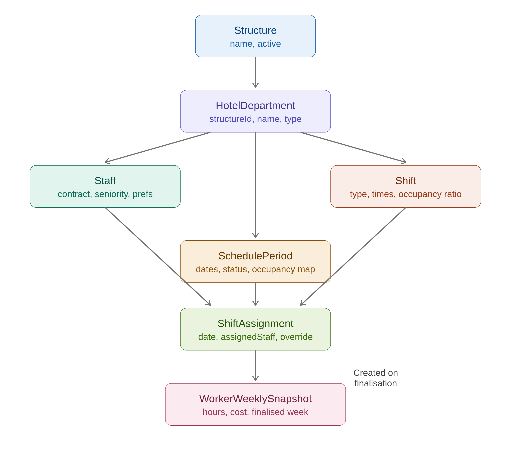

# Hotel Staff Scheduling: a Case Study

Bachelor thesis in Informatics, Università della Svizzera italiana (USI), June 2026.
Advisor: Dr. Andrea Mocci.

This repository documents the project: the research behind it, how the prototype was built and how it was evaluated. The source code is kept in a private repository and is available on request.

<!-- SCREENSHOT: thesis Figure 4, the Schedule tab. Save as images/schedule_tab.png -->


## Why this project exists

Small and medium sized hotels rarely use dedicated software to build their staff schedules. Most rely on a spreadsheet, rebuilt or copied from one week to the next and adjusted by hand. This is not because no scheduling software exists. It is because the tools on the market do not fit what a small hotel actually needs.

Large chains use enterprise platforms that cost thousands of euros per month. Independent hotels have no equivalent. The tools available to them either do too much, forcing them to adopt payroll, HR and POS modules they do not want, or too little, offering nothing more than a digital version of the same blank calendar they already have in Excel. The algorithms exist. What was missing was a tool built around the way a small hotel actually works.

This project is an attempt to build that tool, starting from the requirements.

## Starting from the people who build the schedules

Nothing about the system was designed until the people who would use it had been asked, at length, what they needed.

Seven interviews were conducted with directors and general managers of independent hotels on the Ligurian Riviera, following a semistructured script in Italian. Six were retained for analysis. Every transcript was read and tagged line by line using a coding scheme of ten categories, built on requirements engineering literature: hard constraints, soft constraints, needed features, pain points, informal decision rules, workflows and so on. AI assistance was used only to cross reference the tagged material across interviews; the tagging and the interpretation stayed manual.

This produced around forty candidate features, each traceable to the passages that motivated it. They were ranked by importance and implementation effort, and around twenty made it into the prototype.

A few findings came up in every single interview:

* Every manager builds the schedule in Excel or on paper, from scratch or by copying last week.
* Several managers had already built their own spreadsheet formulas to turn expected guests into required staff.
* Everyone has informal pairing rules, like never leaving a junior alone on an evening shift, and no tool enforces them.
* End of month payroll reconciliation takes hours and is done entirely by hand.
* "I need to be the one who decides," or something close to it, was said in every interview.

From these, three design principles followed and shaped every later decision.

**Standalone first.** The system has to be useful on its own. Integrations are additions, never prerequisites.

**80/20 automation.** The system generates about 80% of the schedule. The manager reviews, adjusts and approves the rest, and nothing is published without explicit approval.

**Hospitality native shifts.** Split shifts, six day weeks, one and a half day rest patterns and strong seasonal swings are the norm in hotels, not the exception, and the tool has to support them natively.

## The prototype

<!-- SCREENSHOT: thesis Figure 2, the architecture diagram. Save as images/architecture.png -->


The prototype is a standard three tier web application. A React frontend talks to a Spring Boot backend through a REST API. The backend runs the Timefold constraint solver, stores everything in MongoDB Atlas and calls the Anthropic Claude API through Spring AI to read occupancy data. Nothing about this architecture is surprising, and that is deliberate: the time was meant to go into the scheduling problem, not into the architecture. The backend was deployed on Render and the frontend on Netlify, behind authentication.

The domain model came straight out of the feature clustering. A structure (the hotel) contains departments, each with its own staff, shift templates and schedule periods, because in every hotel interviewed the restaurant and the reception build their schedules separately. A shift assignment is the unit the solver works on, and a weekly snapshot of each worker is saved permanently once a week is finalised.

<!-- IMAGE: thesis Figure 3, the domain model. Save as images/domain_model.png -->


What it does:

* **Generates the weekly schedule** for each department from staff contracts, shift templates and the required headcount, using Timefold.
* **Calculates staffing from occupancy.** Instead of a fixed number of workers per shift, the manager sets how many guests one worker can serve, and the system derives the headcount from the expected guests for that day.
* **Imports occupancy data with AI.** Every PMS exports its data differently. Rather than writing a parser for each format, the manager uploads whatever file their PMS produces and Claude extracts the daily figures. The manager sees a preview, with uncertain fields highlighted, and confirms before anything is saved. The uploaded file is never stored.
* **Lets the manager override anything.** Any assignment can be changed directly in the grid, overridden shifts are clearly marked, and constraint problems appear as warnings rather than blocking errors.
* **Follows an explicit schedule life cycle,** from draft to generated, published and finalised, where every step is a decision of the manager.
* **Keeps the payroll records.** When a week is finalised, the system saves a permanent record of each worker's shifts, hours, rest days and cost, and the monthly report can be exported as a PDF for whoever handles payroll.

### The constraint model

Every constraint in the solver corresponds to one or more tagged passages from the interviews.

| Hard constraints | Soft constraints |
|---|---|
| No worker on two shifts the same day | At least one senior worker per shift |
| Weekly contracted hours cap | No junior without a senior on the same shift |
| Daily hours cap for each worker | Minimum coverage for each shift |
| Department eligibility | Penalty for every unassigned slot |
| Designated weekly rest day | Preferred shift types |

This is how one of the interview rules, never leaving a junior without senior supervision, looks in Timefold's ConstraintStreams API:

```java
private Constraint juniorNeverAlone(ConstraintFactory factory) {
    return factory.forEach(ShiftAssignment.class)
        .filter(a -> a.getAssignedStaff() != null
                && a.getShift() != null
                && a.getAssignedStaff().getSeniorityLevel() == SeniorityLevel.JUNIOR)
        .ifNotExists(ShiftAssignment.class,
                Joiners.equal(ShiftAssignment::getShift),
                Joiners.equal(ShiftAssignment::getDate),
                Joiners.filtering((junior, other) -> other.getAssignedStaff() != null
                        && other.getAssignedStaff().getSeniorityLevel() == SeniorityLevel.SENIOR))
        .penalize(HardSoftScore.ONE_SOFT, a -> 10)
        .asConstraint("Junior working without senior supervision");
}
```

### Screens

<!-- SCREENSHOTS: thesis Figures 5 to 8. Save under images/ with these names. -->
| Staff | Shifts |
|---|---|
|  |  |

| Occupancy import | Monthly report |
|---|---|
|  |  |

## Evaluation

Five participants from the hotel industry, among them general managers, a restaurant manager, a front office manager and an external evaluator, used the deployed prototype on their own, following a nine step walkthrough with no guidance from me. They then answered a questionnaire covering the System Usability Scale (SUS), how useful they found each feature, how the generated schedules compared to their own, and whether they would adopt the tool.

| | Result |
|---|---|
| SUS, all five participants | 78.5 (Good; the industry average is 68) |
| SUS, excluding the one outlier | 86.9 (Excellent) |
| Most useful features, out of 5 | Occupancy based staffing 4.80, payroll report 4.80, manual override 4.60 |
| Schedule quality | All four participants who schedule staff rated the generated schedule better than their own |
| Would adopt it | 3 of 5, probably or definitely |

The most instructive result was the one that was not a success. The general manager of a very small property, scheduling one to five people, rated the generated schedule much better than what they could do by hand, yet scored the usability at 45 and would probably not adopt it. The scheduling was not the problem; the setup was. For a property that small, configuring staff, shifts and occupancy takes more time than the tool saves each week. That tells me clearly where the tool fits, roughly ten to fifty staff, and what has to come next: a much easier onboarding.

## Limitations and what comes next

This is a prototype that validates the requirements, not a production system. It has no multi tenant accounts or roles yet, manual overrides are not kept when a schedule is solved again, the solver runs synchronously, and fair rotation of unpopular shifts and skill tagging are still missing.

The next steps follow from the evaluation: guided onboarding with an AI setup assistant, automatic weekly generation for the manager to review, a quick setup mode for small properties, and direct PMS integrations where vendors allow it.

The project continues as part of a broader suite of software for hospitality.

## Documents

* [Thesis report (PDF)](docs/thesis_report.pdf)
* [Poster (PDF)](docs/poster.pdf)

## Technologies

Java 21, Spring Boot 3, Spring Data MongoDB, Timefold Solver, Spring AI, Anthropic Claude API, Maven, React, Vite, MongoDB Atlas, Render, Netlify.

## Contact

Theodor Vavassori, [github.com/theodorvavassori](https://github.com/theodorvavassori)
<!-- add LinkedIn once the profile is live -->
Source code and a demo account are available on request.
